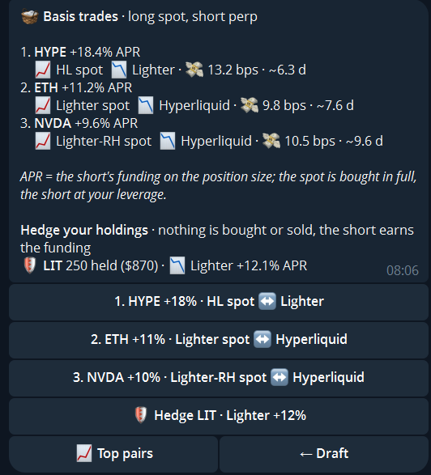
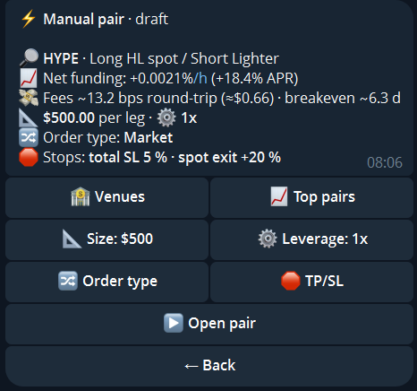

import { Steps, Aside } from '@astrojs/starlight/components';

A **basis trade** is a Delta-Neutral pair whose long leg is the token itself, bought on a spot market, and whose short leg is the perp on any linked venue. The spot pays no funding, so you earn the short's funding. Spot markets are on **Hyperliquid, Lighter and Lighter RH**. The short can be on any venue that offers Delta-Neutral.

The wallet must be in Delta-Neutral mode.

## Open a basis trade

<Steps>

1. Tap `➕ New DN pair`, then `📈 Top pairs` → `🧺 Basis trades`. The list shows the best basis pairs on your linked venues with APR, cost and breakeven time.
2. Pick a row. The draft takes over the spot venue, the short venue and the token.
3. Set the size and the short's leverage (default 1x). The confirmation shows the capital: the spot purchase plus the margin of the short. Mimiq moves the USDC between spot and perps on the same account for you.
4. Optionally set stops (see below), then `▶ Open pair`.

</Steps>

*The numbers are an example, not a forecast.*

The APR is the short's funding on the position size. The spot is bought in full, the short at your leverage.

<Aside type="note" title="Lighter and Lighter RH">
Spot needs one more fee approval on top of your existing one. The basis list shows a `🔐 Approve spot on …` button until you have signed it.
</Aside>

## Hedge tokens you already hold

Already hold the token on a spot market? Under `🧺 Basis trades` → `🛡 Hedge your holdings` Mimiq opens only the short against it. **Nothing is bought or sold**: your tokens are the long leg, and the short earns the funding. The DN menu lists your tokens under `🪙 Spot holdings`.

## Stops and exit

| Option | Meaning |
|---|---|
| Total TP/SL | Take-profit and stop-loss on the combined PnL of both legs, watched by Mimiq |
| Spot exit | Optional, on Hyperliquid: a limit sell of the whole spot at a % above your spot entry. When it fills, the short is closed |

The spot leg has no leverage and no stops of its own on the venue.

<Aside type="caution" title="Your own tokens are never sold">
When the pair opens, Mimiq records what you already held of the token. Closing the pair sells only what the pair bought, never your own tokens. If you sell spot tokens yourself, the short is made smaller to match, never bigger. A small rest below the venue's minimum lot can stay after a close; it is counted into your next basis trade of that token.
</Aside>

## Fees

Spot trades have their own fee schedule on each venue. Mimiq's 1 bp applies to spot as well; on Hyperliquid only on the sale, not on the purchase. The spot fee is taken in the bought token, so the short is sized to what you actually keep. See [Fees](/fees/).
