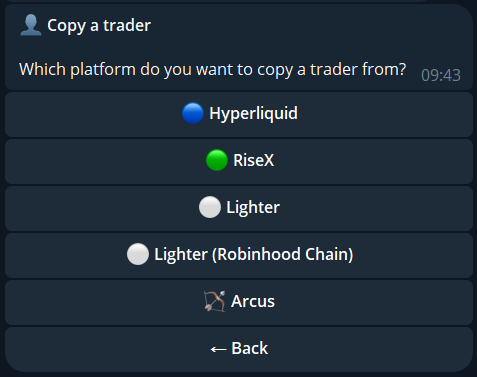
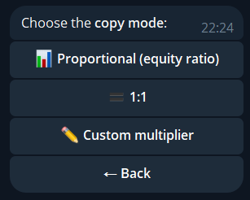
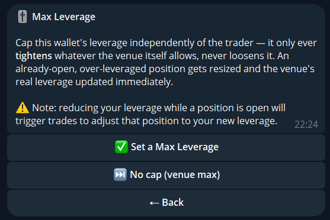
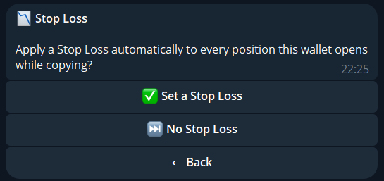
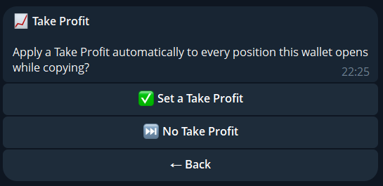
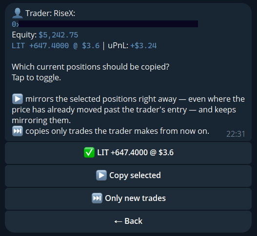
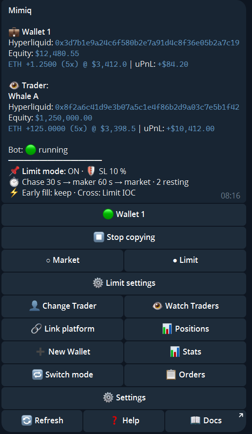
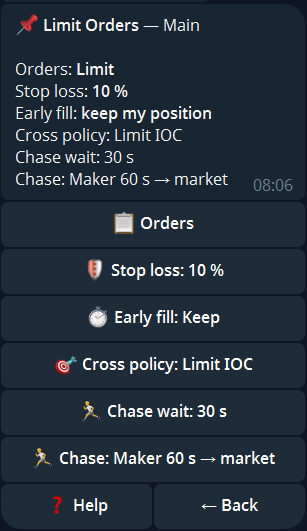

import { Steps, Aside } from '@astrojs/starlight/components';

## Set up

Tap `👤 Set Trader` (`👤 Change Trader` if one is set).

<Steps>

1. **Platform.** Pick where the trader trades. Hyperliquid, Lighter, Lighter RH, RiseX and Arcus can be copied.

   

2. **Trader.** Send the wallet address (`0x…`). On Lighter you can send the account index or the wallet address. If the address has several accounts, pick one.
3. **Mode.** `Proportional`, `1:1` or `Custom` (your own multiplier, for example `2` or `0.5`).

   

4. **Max leverage (optional).** A ceiling for this wallet. It only tightens what the venue allows, never loosens it.

   

5. **Stop-loss and take-profit (optional).** Applied automatically to every position the wallet opens, as a percentage or a dollar amount.

   

   

6. **Thin book.** What happens when the order book cannot fill a copy trade inside your max slippage: `Skip` (the trade is not executed and you get a message; the next move of the trader syncs again) or `Fill in slices` (filled step by step until you are in sync with the trader).

7. **Current positions.** Copy the trader's open positions now, or only trades from now on. You can deselect single positions.

   

</Steps>

Then confirm. Copying starts within about 30 seconds.

Market orders never fill further from the price than your **max slippage** (default 2.0%, under `⚙️ Settings`).

## Sizing

| Mode | Size |
|---|---|
| Proportional | In proportion to your account size |
| 1:1 | The same size as the trader |
| Custom | The trader's size times your multiplier |

Trades below 10 USD are skipped (1 USD on RiseX, Hibachi and Extended). A single copy trade above 500,000 USD is rejected.

## Current positions or new trades only

<Aside>
**Copy current** mirrors the trader's existing book right away, even where the price has moved past their entry, and keeps mirroring everything. **New trades only** copies what the trader does from now on. If the price has moved since the entry, the bot warns you first.
</Aside>

## Start and stop

`▶️ Start copying` and `⏹ Stop copying` are in the menu. When you stop with open positions, you choose:

| Option | Result |
|---|---|
| `🔴 Close all & stop` | Closes every position, then stops |
| `🎯 Choose which to close` | Opens your positions to pick |
| `⏸ Keep positions & stop` | Stops copying, leaves the positions open |

## Limit orders

By default Mimiq copies position changes with market orders. Switch `Market | Limit` in the menu (or `📌 Limit Orders` under Settings) to **Limit**, and the trader's resting limit orders are mirrored on your venue as well. This works for traders on Hyperliquid, Arcus and RiseX, on every target venue.

`⚙️ Limit settings`:

| Setting | Meaning |
|---|---|
| Stop loss | Distance from your entry. Required: without it the trader's opening orders are not copied |
| Early fill | Your order may fill before the trader's: keep your position, or match the trader when the trader cancels or after a time you choose |
| Chase wait | How long your order may keep resting after the trader's filled (0 = at once) |
| Chase | What fills the size your order missed: `Market`, `Maker, then market` (a post-only order follows the best price for the patience you choose, then the rest goes to market) or `Maker only` |
| Cross policy | An order that would cross the book: `Limit IOC` (fill at the trader's price or better), `Skip` or `Taker` |

<Aside type="caution">
Mirrored orders rest on your venue with your margin and can fill at any time, also while you are offline. This includes the trader's orders that open or add to a position. Your stop loss protects the position.
</Aside>

<Aside type="note">
Change the copy mode, limit orders, max slippage, thin book, notifications and names later under [Settings](/guide/main-menu/#settings).
</Aside>
