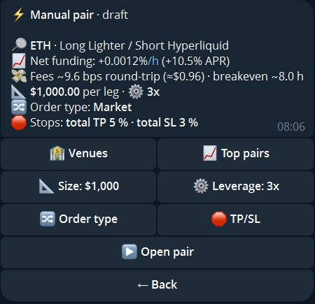

import { Steps, Aside } from '@astrojs/starlight/components';

A Delta-Neutral **pair** is a long on one venue and a short on the same token on another. You hold no price direction and collect the funding difference between the two venues. You need two linked venues.

Switch the wallet with `🔁 Switch mode`, or open `/deltaneutral`.

## Open a pair

`➕ New DN pair` opens a **draft**: one card with the pair and its settings as buttons. Nothing is sent to a venue until you confirm.

*The numbers are an example, not a forecast.*

<Steps>

1. **Choose the pair.** Either tap `🏦 Venues`, pick two linked venues and then a symbol both of them trade, or tap `📈 Top pairs` and pick one of the best pairs by funding right now. The direction follows from the funding rates: long where funding is lowest, short where it is highest. HIP-3 markets on Hyperliquid are behind the `HIP-3` button. A long on a spot market instead of a perp is a [basis trade](/guide/basis-trade/).
2. **Size and leverage.** `📐 Size` is the size per leg, `⚙️ Leverage` the leverage of both legs.
3. **Order type.** `🔀 Order type` chooses how the legs are filled:

   | Type | Meaning |
   |---|---|
   | Market | Both legs now, at the best prices |
   | Limit | A resting order at the touch on each leg |
   | Chase | A resting order that follows the market until it is filled |
   | TWAP | Split into tranches over time; each tranche is a market or a chase order |

   Under `— Per leg —` each leg can get its own type, for example limit on one venue and market on the other. With limit or chase you also set the timeout or the chase settings.

4. **Stops (optional).** `🛑 TP/SL` sets take-profit and stop-loss on each leg, and a **total TP/SL** on the combined PnL of both legs. The total stop comes on top of the stops on the legs, never instead of them.
5. **Open.** `▶ Open pair` shows a short confirmation. Confirm, and the bot opens both legs. Afterwards it asks whether to close the pair automatically when funding turns against it.

</Steps>

<Aside type="note">
Each order type is offered only where both venues support it.
</Aside>

## Manage a pair

`📊 Positions` lists your positions and your pairs. Open a pair to see its details and use:

| Button | Effect |
|---|---|
| `🎯 TP/SL` | Take-profit and stop-loss on both legs, as a price, a % move per leg, or a $ PnL per leg, and the total TP/SL |
| `🛡 Auto-close` | Close the pair when funding turns against it |
| `💰 Cost cap` | Limit what the funding-turn close may cost; `🗑 Remove cap` clears it |
| `📈 Chart` | A chart of the pair |
| `❌ Close` | Close both legs after a confirmation that shows the expected PnL |

<Aside type="caution">
Every pair is a real position on both venues. If one venue is unreachable, the bot tells you instead of guessing the state.
</Aside>
