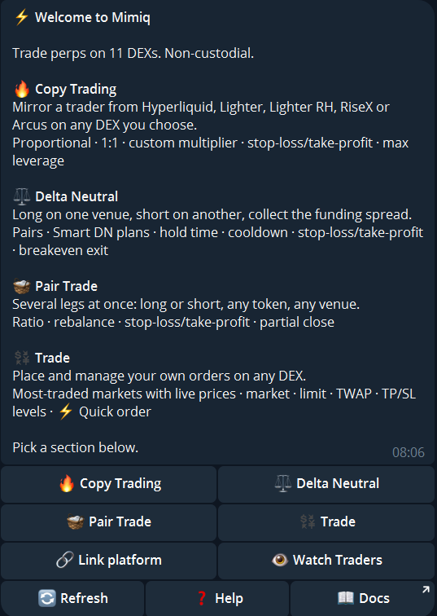
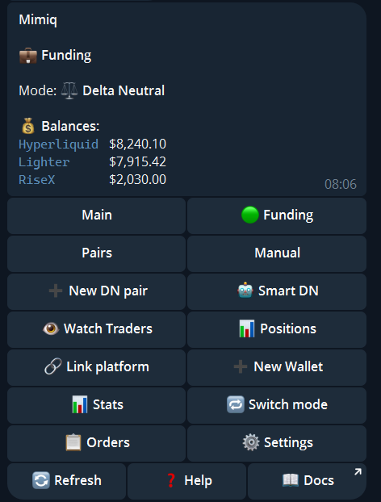
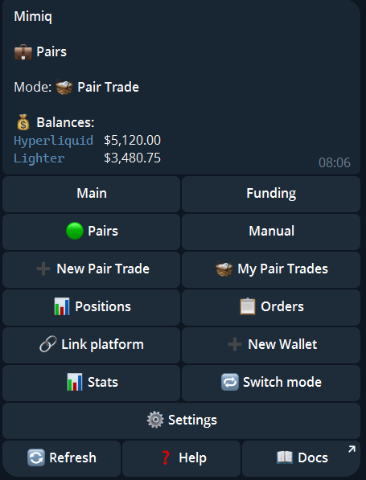
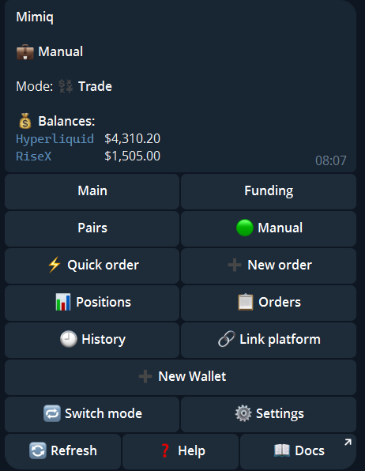
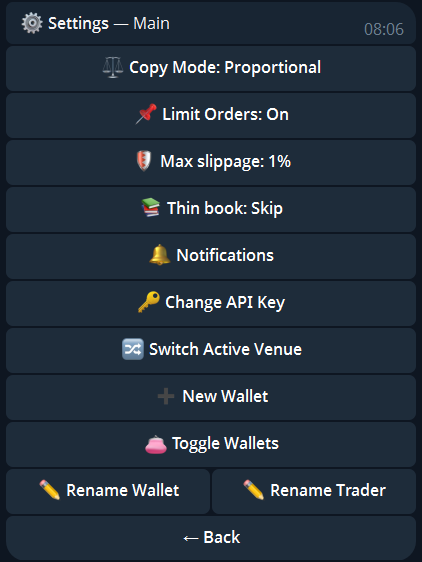

import { Aside } from '@astrojs/starlight/components';

Open the bot and send `/start`. The menu shows the status of the selected wallet and the buttons for its mode. Every mode has `📊 Positions`, `📋 Orders`, `🔗 Link platform`, `➕ New Wallet`, `🔁 Switch mode`, `⚙️ Settings`, `🔄 Refresh`, `❓ Help` and `📖 Docs`.

Without a wallet yet, the menu offers the four modes: `🔥 Copy Trading`, `⚖️ Delta Neutral`, `🧺 Pair Trade` and `💱 Trade`. [Which mode?](/start/which-mode/) compares them.

## Copy mode

`👤 Set Trader` (`👤 Change Trader` once one is set) and `▶️ Start copying` / `⏹ Stop copying` run the copy. Below them, `Market | Limit` chooses whether the trader's resting limit orders are mirrored too. Also here: `👁 Watch Traders` and `📊 Stats`.

More: [Copy trading](/guide/copy-trading/), [Watch traders](/guide/watch-traders/), [Link a venue](/guide/link-venue/).

## Delta-Neutral mode

`➕ New DN pair` and `🤖 Smart DN` replace the trader buttons. `📊 Positions` shows your open positions and your pairs. See [Delta-Neutral](/guide/delta-neutral/) and [Smart DN plans](/guide/smart-dn/).

## Pair Trade mode

`➕ New Pair Trade` builds a new trade, `🧺 My Pair Trades` lists yours. See [Pair Trade](/guide/pair-trade/).

## Trade mode

`⚡ Quick order` and `➕ New order` open the order ticket, `🕘 History` lists your past orders. See [Trade](/guide/trade/).

## Orders

`📋 Orders` (or `/orders`) lists every open order of the wallet, grouped by mode: resting limit orders and stop levels on the venues, Trade orders and TWAPs, Pair Trade legs waiting for a fill, queued Delta-Neutral entries and mirrored limit orders. Each order on a venue has its own cancel button, and `Cancel all` asks first. If a venue cannot be read, the screen says so instead of showing no orders.

## Settings

`⚙️ Settings` opens:

| Button | What it does |
|---|---|
| `⚖️ Copy Mode` | `📊 Proportional (equity ratio)`, `🟰 1:1` or `✏️ Custom multiplier` |
| `📌 Limit Orders` | Mirror the copied trader's resting limit orders, see [Copy trading](/guide/copy-trading/#limit-orders) |
| `🛡 Max slippage` | How far from the price a market order may fill: 0.3, 0.5, 1.0, 1.5 or 2.0% (default 2.0%) |
| `📚 Thin book` | When the order book cannot fill a copy trade inside your max slippage: `Skip` or `Fill in slices` |
| `🔔 Notifications` | Toggle **Fills**, **Closes** and **Errors** |
| `🔑 Change API Key` | Replace the credentials of a linked venue |
| `🔀 Switch Active Venue` | Choose which linked venue the wallet trades on |
| `➕ New Wallet` | Create another wallet |
| `👛 Toggle Wallets` | Choose which wallets show in the menu. Hidden wallets keep running |
| `✏️ Rename Wallet` | Rename the wallet |
| `✏️ Rename Trader` | Rename the copied trader |

A Trade wallet has its own settings: default leverage, default size, a confirmation for small orders, max slippage and the quick-order defaults.

## Stats and history

`📊 Stats` (or `/stats`) shows total volume, total PnL, total fees and the blended cost per 1M traded, DN funding collected, and volume, cost per 1M and fees for each venue. A leading `≈` means the fee figure is partly an estimate.

`/history` lists your recent trades and the closed Delta-Neutral pairs with their result. `/status` shows the wallet, its mode and its trader.

## Commands

| Command | Shows |
|---|---|
| `/start` | Main menu |
| `/setup` | Link a platform |
| `/positions` | Open positions |
| `/orders` | Open orders |
| `/history` | Recent trades |
| `/stats` | Volume, fees, PnL, funding |
| `/status` | Wallet and trader status |
| `/deltaneutral` | Delta-Neutral menu |
| `/leavewaitlist` | Delete your waitlist entry |

<Aside>Commands act on the wallet that is selected in the menu.</Aside>
