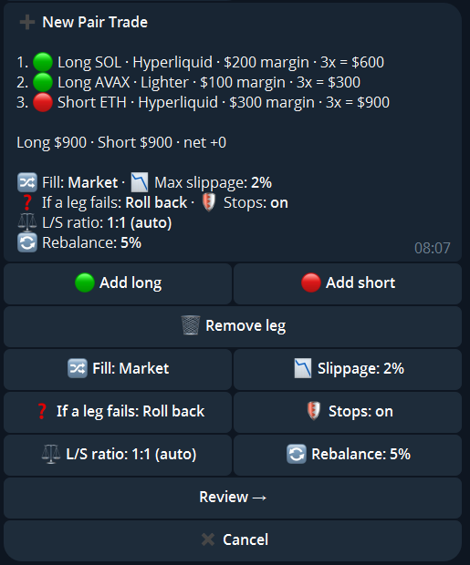

import { Steps, Aside } from '@astrojs/starlight/components';

A **Pair Trade** is a set of legs that you open and close together: long or short, any token, any linked venue, each leg with its own size and leverage. Typical uses are long one token against short another, or a basket of longs against a basket of shorts.

Switch the wallet with `🔁 Switch mode` → Pair Trade. The menu then shows `➕ New Pair Trade` and `🧺 My Pair Trades`.

## Build a Pair Trade

<Steps>

1. Tap `➕ New Pair Trade`.
2. **Add legs.** `🟢 Add long` or `🔴 Add short`, then pick the venue, type the token, and enter the size and leverage. Repeat for every leg. A token on a Hyperliquid builder dex is typed with its dex, for example `xyz:AAPL`. `🗑 Remove leg` takes one out again.
3. **Settings.** Every setting is a button with its current value:

   | Setting | Meaning |
   |---|---|
   | `🔀 Fill` | `Market` (all legs at once), `Limit` (a resting order per leg, at your price) or `Chase` (the order follows the market until it is filled). Each leg can get its own type, and a market fill can be spread over time as a TWAP |
   | `📉 Slippage` | No market order is sent beyond this distance from the price |
   | `⏱ Timeout` | With limit orders: how long they may rest before they are cancelled |
   | `❓ If a leg fails` | When not every leg fills: `Roll back` (close what filled), `Ask me` (buttons: retry the missing legs, close what filled, or keep as is) or `Retry x2` (try twice, then ask) |
   | `🛡 Stops` | Take-profit and stop-loss per leg, and a total TP/SL on the combined PnL |
   | `⚖️ L/S ratio` | How big the long side is against the short side. `Auto` (default) follows the sizes of your legs |
   | `🔄 Rebalance` | Off by default. When on, Mimiq brings the two sides back to your ratio once they drift further apart than the threshold you set |

4. `Review →`, then `🚀 Open Pair Trade`.

   

</Steps>

<Aside type="note" title="Rebalance">
With rebalance **off**, Mimiq never trades on the balance. If you close part of a leg yourself you get a warning, nothing more. With rebalance **on**, `Trim` makes the bigger side smaller with reduce-only orders, and `Grow + trim` first grows the smaller side as far as its free margin allows and trims the rest from the bigger side.
</Aside>

## Manage a Pair Trade

`🧺 My Pair Trades` lists your Pair Trades with their status. Open one to see every leg with its fill and entry, and use:

| Button | Effect |
|---|---|
| `Close <token>` | Close one leg |
| `✂️ Close part` | Close a share of the legs at market; the legs stay open with the rest |
| `Close all legs` | Close the whole Pair Trade, after a confirmation |
| `📈 Chart` | A chart of the Pair Trade |

<Aside type="caution">
Every leg is a real position on its venue. If a leg cannot be filled, the bot follows your `If a leg fails` setting and tells you what it did.
</Aside>
