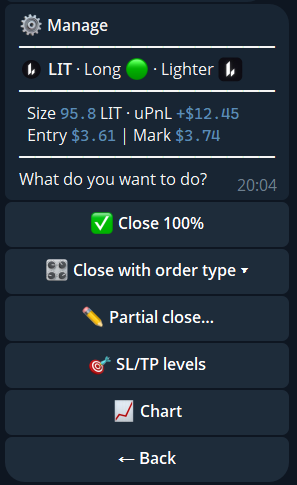
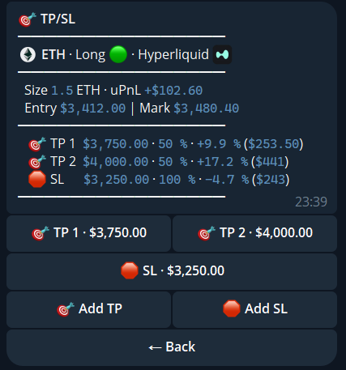
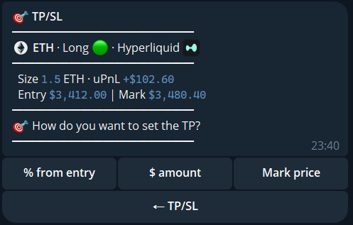

`📊 Positions` (or `/positions`) is the same screen in every mode. It lists your open positions across the venues linked to the wallet, plus your Delta-Neutral pairs and Pair Trades. Open a position to manage it. Open orders are under [`📋 Orders`](/guide/main-menu/#orders).

## Close

| Button | Effect |
|---|---|
| `✅ Close 100%` | Closes the whole position |
| `🎛 Close with order type ▾` | Closes with a limit, chase or TWAP order instead of a market order |
| `✏️ Partial close…` | Closes a part you enter |
| `💣 Close all` | Closes every open position, after a confirmation |

`📈 Chart` shows the price chart of the position's market.

## Stop-loss and take-profit

In a position, `🎯 SL/TP levels` opens the TP/SL screen. It lists every stop that rests on the venue for this position: its trigger price, how much of the position it closes, and how far it is from the entry in % and $. Each stop has its own button.

- `🎯 Add TP` / `🛑 Add SL` sets a new stop. You choose how to give it: in % from the entry, as a $ gain or loss, or as a price. Then you choose how much of the position it closes (25 %, 50 % or 100 %, only what is still free).
- Tap a stop to change its price (and its size, where a venue takes several levels), or `🗑 Remove` it (asked once more before it is removed).

A stop set here lives on the venue as a native order. Some venues keep only one TP and one SL per position: there the buttons read `🎯 Set TP` / `🛑 Set SL` and only show while that stop is missing.

To protect every copy position automatically, set SL/TP in the [copy setup](/guide/copy-trading/). For Delta-Neutral pairs, see [Delta-Neutral](/guide/delta-neutral/), for Pair Trades [Pair Trade](/guide/pair-trade/).
