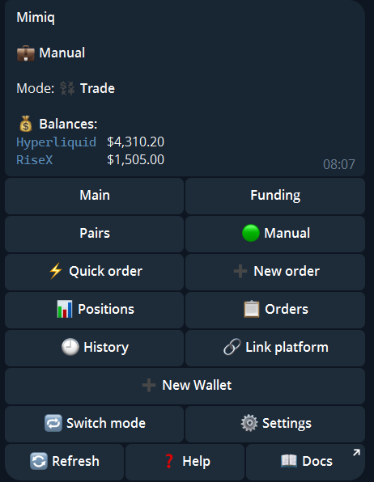
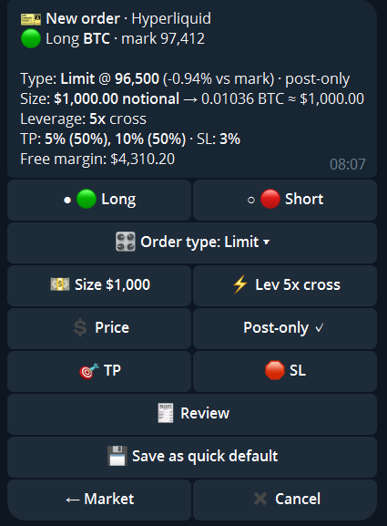

import { Steps, Aside } from '@astrojs/starlight/components';

In **Trade** mode you place your own orders, one at a time, on any venue linked to the wallet. Mimiq executes them and watches the TP/SL levels you set.

Switch the wallet with `🔁 Switch mode` → Trade. The home screen shows the balances of every linked venue and `⚡ Quick order`, `➕ New order`, `📊 Positions`, `📋 Orders` and `🕘 History`.

## Place an order

<Steps>

1. Tap `➕ New order` and pick the venue. On Hyperliquid you also pick the dex.
2. **Choose the market.** Tap one of the suggested most-traded markets with their live prices, or type the token.
3. **Fill in the ticket.** One screen with everything as buttons: `🟢 Long` or `🔴 Short`, `💵 Size`, `⚡ Lev` (leverage, cross or isolated), the order type, `🛡 Slippage`, `🎯 TP` and `🛑 SL`. Add more take-profit or stop-loss levels with `🎯 + TP level` and `🛑 + SL level`.
4. `🧾 Review`, then confirm. The bot sends the result as a message.

   

</Steps>

## Order types

`🎛 Order type` opens the list:

| Type | Meaning |
|---|---|
| Market | Now, at the best prices, inside your max slippage |
| Limit | One order at your price (`💲 Price`), optionally post-only |
| TWAP | Split into tranches over time |
| Chase | A resting order that follows the market until it is filled |
| Scale | Several orders spread between two prices |

TWAP, Chase and Scale each have their own settings screen.

## Quick order

On any ticket, `💾 Save as quick default` saves the venue, size, leverage and TP/SL. From then on `⚡ Quick order` on the home screen opens a ticket with these values already filled in. You can clear the defaults in the Trade settings.

## Manage

`📊 Positions` lists your open positions. From a position you can close or reduce it with the same ticket and order types. `📋 Orders` lists your open orders with a cancel button each, and `🕘 History` your past orders.

<Aside type="note" title="Settings">
`⚙️ Settings` of a Trade wallet holds the default leverage, the default size, a confirmation for small orders, your max slippage and the quick-order defaults.
</Aside>

<Aside type="caution">
A wallet can switch to Trade only when nothing else runs on it: no active copy, no open pair and no account shared with an automated wallet. The bot tells you what blocks the switch.
</Aside>
