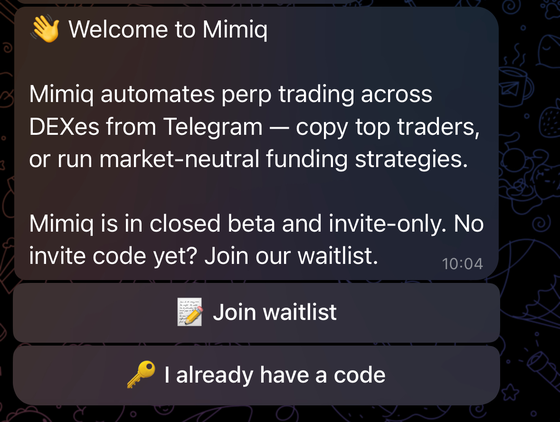
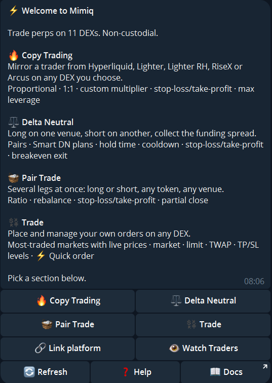

1. **Open the bot** on Telegram: [@Mimiq2bot](https://t.me/Mimiq2bot). Enter your invite code. No code yet? Join the waitlist in the bot. Mimiq lets people in step by step.

   

2. **Link a venue.** The bot asks for the venue's API credentials. [Link a venue](/guide/link-venue/) shows every screen, with Hyperliquid as the example. Your message with the key is deleted from the chat, and the key is stored encrypted.
3. **Approve the fee once.** On Hyperliquid, Lighter, Lighter RH and RiseX the bot sends a signing link. You sign with your wallet.
4. **Pick a mode.** [Copy trading](/guide/copy-trading/) needs one venue, [Delta-Neutral](/guide/delta-neutral/) needs two. [Pair Trade](/guide/pair-trade/) and [Trade](/guide/trade/) work with one venue or more. [Which mode?](/start/which-mode/) compares them.

   

5. **Start.** In Copy and Delta-Neutral the bot opens and closes positions for you. In Pair Trade and Trade you place the orders, and the bot executes and watches them.

Orders below 10 USD are skipped (1 USD on RiseX, Hibachi and Extended).
